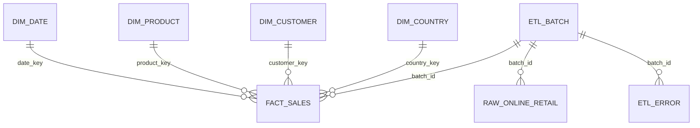

# Báo cáo triển khai Online Retail II

Ngày kiểm tra: 15/11/2026. Tài liệu này bổ sung kết quả thực hiện cho kế hoạch; không thay đổi tài liệu kế hoạch gốc.

## Kiến trúc

Nguồn XLSX → bộ đọc streaming Python → staging/raw + nhật ký/lỗi → làm sạch và phân loại → COPY bảng tạm → dimension → fact → đối chiếu → SQL/Power BI.

Star schema gồm một fact 14 cột và bốn dimension. Staging và fact dùng định danh dòng `(source_file_id, source_row_id)`; mã file là SHA-256, số dòng liên tục qua hai sheet. Bản ghi trùng nghiệp vụ ở các dòng nguồn khác nhau vẫn giữ nguyên. Các lần nạp lại được ghi thành batch mới, chỉ bỏ qua insert vào những khóa nguồn đã tồn tại.

Khách thiếu mã dùng customer_key=0. Tên sản phẩm là mô tả không trống mới nhất theo InvoiceDate; hòa thời điểm chọn SHA file rồi số dòng lớn hơn. Không loại mã phí đặc biệt. Giữ năm gốc 2009–2011 và giờ phút trong fact, bảng ngày chỉ giữ phần ngày.

## Kết quả nguồn và PostgreSQL

Đọc trực tiếp file `online-retail-ii.xlsx`, SHA-256 `bcbe73b35f5b7babf197fb0cb983a11f5d9ff929078d4aa53d171b1f2df2e980`.

| Sheet | Đọc | Hợp lệ | Loại |
|---|---:|---:|---:|
| Year 2009-2010 | 525.461 | 521.770 | 3.691 |
| Year 2010-2011 | 541.910 | 539.393 | 2.517 |
| Tổng | 1.067.371 | 1.061.163 | 6.208 |

6.207 dòng có giá không dương, một dòng có mã C nhưng số lượng dương. Giá nguồn có tối đa ba chữ số thập phân sau khi diễn giải số Excel; chọn numeric(12,4). XML chứa nhiễu biểu diễn nhị phân được diễn giải như số Excel trước khi tạo Decimal, tránh loại nhầm hơn một trăm nghìn dòng.

243.007 dòng nguồn thiếu mã khách; 4.382 dòng thiếu mô tả sau trim. Số thiếu mô tả này khác con số tham khảo 4.474 trong kế hoạch, nên báo cáo dùng kết quả đo trên file thực tế. Có 34.335 dòng trùng hoàn toàn sau chuẩn hóa giá trị đọc, vẫn giữ nguyên.

| Loại | Dòng | Tổng tiền GBP |
|---|---:|---:|
| SALE | 1.041.670 | 20.972.594,5680 |
| RETURN_CANCELLATION | 19.493 | -1.527.041,4300 |
| ADJUSTMENT | 0 | 0,0000 |

Doanh thu sau điều chỉnh: **19.445.553,1380 GBP**, hiển thị hai chữ số lẻ là **19.445.553,14 GBP**. Giá trị hủy hiển thị dạng trị tuyệt đối. Chưa xác nhận hoàn tiền hay đối chiếu từng đơn hủy với đơn gốc.

Các số liệu nguồn ở `docs/data_profile.md` và JSON cùng tên. Bằng chứng PostgreSQL ở `docs/results/full_postgres.json` và `.log`.

## Phạm vi kiểm tra

- Bảy nhóm unittest: mọi tổ hợp dấu và tiền tố, chuẩn hóa mã, tiền Decimal, dòng sai kiểu/miền, COPY null/chuỗi rỗng/ký tự đặc biệt số dòng xuyên sheet, đối chiếu tổng tiền độc lập và batch rỗng.
- PostgreSQL thực, cluster tạm ở chế độ single-user: DDL, khóa, SQL nạp dimension/fact, khách khóa 0, tên mới nhất và chống ghi đè tên bằng dữ liệu cũ.
- Nạp toàn bộ workbook bằng quy tắc Python và câu SQL production: 1.061.163 fact, tổng tiền theo loại khớp Python, insert lần hai bằng 0, một batch và hai batch có cùng số dòng/tổng tiền.
- Q1–Q5, KPI, truy vấn tháng 12 tương đương và `05_checks.sql` thực thi không lỗi trên dữ liệu đã nạp.

Kiểm tra toàn nguồn chạy trong cluster tạm rồi xóa; không có database dịch vụ tồn tại sau kiểm tra. Harness không chạy toàn bộ orchestration psycopg2, cũng không nạp raw/error đầy đủ như runner; vì vậy chưa dùng kết quả này để xác nhận nhật ký staging của runner.

## Những phần cần môi trường tiếp theo

Môi trường hiện chặn mạng cài dependency và mở socket PostgreSQL. Runner qua psycopg2 đã được triển khai nhưng chưa kiểm tra kết nối và transaction từ đầu đến cuối. Dùng README để chạy trên PostgreSQL dịch vụ, sau đó chạy lại và xác nhận staging, lỗi, nhật ký và số tiền.

Chưa có Power BI Desktop: đã chuẩn bị DAX, Power Query, quan hệ và bố cục ba trang; chưa có `.pbix`, ảnh dashboard hoặc đối chiếu DAX/SQL. Chưa đo trung vị năm lần trên database dịch vụ; công cụ benchmark đã có. Mẫu hóa đơn được chọn và tính tự động trong JSON, chưa được tính tay. Chưa có PDF báo cáo cuối kỳ; tài liệu Markdown này có thể xuất PDF sau khi bổ sung kết quả Power BI và benchmark.

## Nguồn

Theo tài liệu kế hoạch: D. Chen (2012), UCI Online Retail II, DOI 10.24432/C5CG6D, giấy phép CC BY 4.0. Không dịch năm hoặc sửa file nguồn. Ngày tải chưa được xác nhận.
