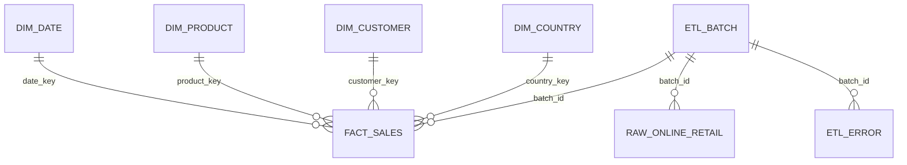

# Báo cáo triển khai Online Retail II

Cập nhật ngày 24/11/2026. Hai đợt nạp trên PostgreSQL dịch vụ `retail_dwh` đã hoàn tất. Kho ghi nhận **1.061.163 dòng giao dịch** và **19.445.553,14 GBP doanh thu sau điều chỉnh** từ hai sheet của Online Retail II.

## Kiến trúc

Nguồn XLSX → bộ đọc streaming Python → staging/raw + nhật ký/lỗi → làm sạch và phân loại → COPY bảng tạm → dimension → fact → đối chiếu → SQL/Power BI.

Star schema gồm một fact 14 cột và bốn dimension. Staging và fact dùng định danh dòng `(source_file_id, source_row_id)`; mã file là SHA-256, số dòng liên tục qua hai sheet. Bản ghi trùng nghiệp vụ ở các dòng nguồn khác nhau vẫn giữ nguyên. Các lần nạp lại được ghi thành batch mới, chỉ bỏ qua insert vào những khóa nguồn đã tồn tại.

Khách thiếu mã dùng customer_key=0. Tên sản phẩm là mô tả không trống mới nhất theo InvoiceDate; hòa thời điểm chọn SHA file rồi số dòng lớn hơn. Không loại mã phí đặc biệt. Giữ năm gốc 2009–2011 và giờ phút trong fact, bảng ngày chỉ giữ phần ngày.

## Kết quả nguồn và PostgreSQL

Đọc trực tiếp file `online-retail-ii.xlsx`, SHA-256 `bcbe73b35f5b7babf197fb0cb983a11f5d9ff929078d4aa53d171b1f2df2e980`.

| Batch và sheet | Đọc | Hợp lệ | Loại | Chèn mới | Đã có | Thời gian |
|---|---:|---:|---:|---:|---:|---:|
| 1 · Year 2009-2010 | 525.461 | 521.770 | 3.691 | 521.770 | 0 | 00:01:56.458176 |
| 2 · Year 2010-2011 | 541.910 | 539.393 | 2.517 | 539.393 | 0 | 00:02:02.475426 |
| **Tổng** | **1.067.371** | **1.061.163** | **6.208** | **1.061.163** | **0** | **00:03:58.933602** |

Cả hai batch đều có trạng thái `SUCCESS`. Trong từng batch, số dòng đọc bằng số hợp lệ cộng số bị loại, và số hợp lệ bằng số chèn mới cộng số đã có. Bảng fact vượt ngưỡng 100.000 dòng và khớp tổng số dòng chèn mới. Truy vấn kiểm tra trả về 0 khóa nguồn bị lặp và 0 dòng fact thiếu liên kết tới bốn bảng chiều. PostgreSQL liệt kê 46 ràng buộc trong schema `dw`.

6.207 dòng có giá không dương, một dòng có mã C nhưng số lượng dương. Giá nguồn có tối đa ba chữ số thập phân sau khi diễn giải số Excel; chọn numeric(12,4). XML chứa nhiễu biểu diễn nhị phân được diễn giải như số Excel trước khi tạo Decimal, tránh loại nhầm hơn một trăm nghìn dòng.

243.007 dòng nguồn thiếu mã khách; 4.382 dòng thiếu mô tả sau trim. Số thiếu mô tả này khác con số tham khảo 4.474 trong kế hoạch, nên báo cáo dùng kết quả đo trên file thực tế. Có 34.335 dòng trùng hoàn toàn sau chuẩn hóa giá trị đọc, vẫn giữ nguyên.

| Loại | Dòng | Tổng tiền GBP |
|---|---:|---:|
| SALE | 1.041.670 | 20.972.594,5680 |
| RETURN_CANCELLATION | 19.493 | -1.527.041,4300 |
| ADJUSTMENT | 0 | 0,0000 |

Doanh thu sau điều chỉnh: **19.445.553,1380 GBP**, hiển thị hai chữ số lẻ là **19.445.553,14 GBP**. Giá trị hủy hiển thị dạng trị tuyệt đối. Chưa xác nhận hoàn tiền hay đối chiếu từng đơn hủy với đơn gốc.

Trong bảng fact, 236.870 dòng dùng khóa khách hàng 0, tương đương 22,32% số dòng được giữ lại. Doanh thu toàn kho bao gồm cả các dòng này. Bảng xếp hạng khách hàng chỉ tính giao dịch bán có mã khách xác định.

## Kết quả phân tích bán hàng

| Chỉ tiêu toàn kỳ | Kết quả |
|---|---:|
| Doanh thu bán hàng | 20.972.594,5680 GBP |
| Giá trị hủy và điều chỉnh âm, tính theo trị tuyệt đối | 1.527.041,4300 GBP |
| Doanh thu sau điều chỉnh | 19.445.553,1380 GBP |
| Số hóa đơn bán phân biệt | 40.077 |
| Số khách có mã xác định từng mua hàng | 5.878 |
| Doanh thu bán hàng bình quân mỗi hóa đơn bán | 523,31 GBP |

**Theo thời gian.** Trong 25 tháng có dữ liệu, tháng 11/2011 đạt doanh thu bán hàng cao nhất với 1.509.496,33 GBP. Tháng 12/2011 chỉ có dữ liệu đến ngày 09. So cùng kỳ từ ngày 01 đến 09/12, doanh thu lần lượt là 402.270,20 GBP năm 2009, 877.705,30 GBP năm 2010 và 638.810,68 GBP năm 2011. Giá trị hủy và điều chỉnh âm cao nhất vào tháng 12/2011, đạt 205.124,67 GBP ngay trong khoảng chín ngày này.

**Theo thị trường.** Trong 43 giá trị quốc gia/vùng ghi nhận, United Kingdom dẫn đầu với 17.870.977,7770 GBP, chiếm 85,21% doanh thu bán hàng. EIRE đứng thứ hai với 664.431,78 GBP, tiếp theo là Netherlands với 554.232,34 GBP.

**Theo sản phẩm và khách hàng.** Mã 22423 (REGENCY CAKESTAND 3 TIER) đứng đầu với 344.563,25 GBP. Hai vị trí kế tiếp là M (Manual, 340.716,28 GBP) và DOT (DOTCOM POSTAGE, 322.657,48 GBP) vì dự án giữ cả mã ghi nhận thủ công và mã phí. Trong nhóm khách có mã, khách 18102 dẫn đầu với 608.821,65 GBP, tiếp theo là khách 14646 với 528.602,52 GBP.

Toàn bộ kết quả gồm doanh thu và giá trị hủy theo tháng, doanh thu theo thị trường, hai bảng xếp hạng top 10, KPI, so sánh tháng 12 và danh sách ràng buộc. [Dữ liệu chi tiết của 14 truy vấn](../results/retail_dwh_sql.json) · [SQL phân tích](../../sql/04_analysis_queries.sql) · [SQL kiểm tra](../../sql/05_checks.sql)

## Đối chiếu Power BI

Báo cáo [retail.pbix](../../powerbi/retail.pbix) gồm ba trang. Các kết quả dưới đây đối chiếu giá trị hiển thị trong ảnh của từng trang với PostgreSQL. Tiền được làm tròn đến 0,01 GBP.

| Phạm vi | Giá trị trên Power BI | Kết quả SQL |
|---|---|---|
| Tổng quan · doanh thu bán, giá trị hủy, doanh thu sau điều chỉnh | 20.972.594,57 · 1.527.041,43 · 19.445.553,14 GBP | Khớp cả ba |
| Tổng quan · hóa đơn bán, bình quân mỗi hóa đơn, khách có mã | 40.077 · 523,31 GBP · 5.878 | Khớp cả ba |
| Tổng quan · dòng đọc, hợp lệ, bị loại, thiếu mã khách trong fact | 1.067.371 · 1.061.163 · 6.208 · 236.870 | Khớp cả bốn |
| Khách hàng · mười khách có doanh thu cao nhất | Tổng 2.826.476,26 GBP, dẫn đầu là khách 18102 với 608.821,65 GBP | Khớp mười mã và doanh thu từng khách |
| Quá trình nạp · batch 1, Year 2009-2010 | SUCCESS, đọc 525.461, hợp lệ và chèn mới 521.770, loại 3.691, thiếu mã khách 104.267 | Khớp nhật ký lô và số fact có customer_key = 0 của lô 1 |

**Chênh lệch ở bảng sản phẩm.** Ảnh hiển thị 11 dòng mô tả cho 10 mã sau khi nhóm, tổng 2.161.204,12 GBP. PostgreSQL giữ riêng các mã theo chữ hoa/thường. Power BI hiển thị 185.566,47 GBP cho nhóm 85099B/b (183.454,83 + 2.111,64) và 340.731,33 GBP cho M/m (340.716,28 + 15,05). Hai mô tả của 85123A/a tạo hai dòng 263.109,67 và 3.992,39 GBP. Để tái lập Q3 trên Power BI, cần xếp hạng theo khóa số product_key. Các chênh lệch này thuộc phạm vi xếp hạng sản phẩm. Tổng doanh thu toàn kỳ khớp SQL.

[Ảnh tổng quan](../../powerbi/Screenshot%202026-11-24%20183955.png) · [Ảnh sản phẩm và khách hàng](../../powerbi/Screenshot%202026-11-24%20184041.png) · [Ảnh quá trình nạp với batch 1](../../powerbi/Screenshot%202026-11-24%20184119.png)

## Phạm vi kiểm tra

- Bảy nhóm unittest: mọi tổ hợp dấu và tiền tố, chuẩn hóa mã, tiền Decimal, dòng sai kiểu/miền, COPY null/chuỗi rỗng/ký tự đặc biệt số dòng xuyên sheet, đối chiếu tổng tiền độc lập và batch rỗng.
- PostgreSQL thực, cluster tạm ở chế độ single-user: DDL, khóa, SQL nạp dimension/fact, khách khóa 0, tên mới nhất và chống ghi đè tên bằng dữ liệu cũ.
- Nạp toàn bộ workbook bằng quy tắc Python và câu SQL production: 1.061.163 fact, tổng tiền theo loại khớp Python, insert lần hai bằng 0, một batch và hai batch có cùng số dòng/tổng tiền.
- Q1–Q5, KPI, truy vấn tháng 12 tương đương và `05_checks.sql` thực thi không lỗi trên dữ liệu đã nạp.

Kiểm tra toàn nguồn chạy trong cluster tạm rồi xóa; không có database dịch vụ tồn tại sau kiểm tra. Harness không chạy toàn bộ orchestration psycopg2, cũng không nạp raw/error đầy đủ như runner; vì vậy chưa dùng kết quả này để xác nhận nhật ký staging của runner.

## Những phần cần môi trường tiếp theo

Trên PostgreSQL dịch vụ, nhật ký xác nhận hai batch nạp lần đầu. Bước kiểm tra tiếp theo là nạp lại cùng workbook và xác nhận mỗi batch mới có `rows_inserted = 0`. Kết quả nạp lại hiện có thuộc bộ kiểm thử trên cluster tạm. [Kết quả kiểm thử toàn bộ workbook](../results/full_postgres.json)

Chưa đo trung vị năm lần trên database dịch vụ; công cụ benchmark đã có. Mẫu hóa đơn được chọn và tính tự động trong JSON, chưa được tính tay. Chưa có PDF báo cáo cuối kỳ; tài liệu Markdown này có thể xuất PDF sau khi bổ sung benchmark.

## Nguồn

Theo tài liệu kế hoạch: D. Chen (2012), UCI Online Retail II, DOI 10.24432/C5CG6D, giấy phép CC BY 4.0. Không dịch năm hoặc sửa file nguồn. Ngày tải chưa được xác nhận.
